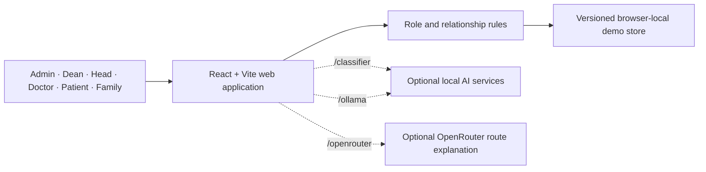

# CareBridge 3.0

> One platform for connected, consent-aware care across hospitals, clinicians, patients, and approved family caregivers.

[Open the live demo](https://carebridge-sairam-live.glossyharp64.chatgpt.site/) · [View the GitHub repository](https://github.com/PSujith-Kumar/sri-sai-ram-hackathon-24-hr-)

CareBridge is a responsive multi-hospital healthcare-assistance prototype built for the Sairam VERDICT hackathon. It combines hospital administration, role-scoped patient access, queues, appointments, indoor navigation, health reports, medicines, family coordination, and an optional AI wellbeing companion in one React application.

The repository uses only fictional hospitals and patients. It is a demonstration platform, not a production electronic health record, diagnostic system, or emergency-dispatch service.

## Contents

- [Why CareBridge](#why-carebridge)
- [Demo data](#demo-data)
- [Features](#features)
- [Roles and access](#roles-and-access)
- [System architecture](#system-architecture)
- [Technology stack](#technology-stack)
- [Run locally](#run-locally)
- [Optional AI services](#optional-ai-services)
- [Testing](#testing)
- [Project structure](#project-structure)
- [Important business rules](#important-business-rules)
- [Privacy, safety, and limitations](#privacy-safety-and-limitations)
- [Deployment](#deployment)
- [Troubleshooting](#troubleshooting)
- [Contributing](#contributing)

## Why CareBridge

Healthcare journeys are often split across separate systems: hospital administration, queue desks, clinical notes, medicine reminders, navigation, and family communication. CareBridge demonstrates how those workflows can be connected while still limiting each person to the minimum information their role and relationships permit.

The prototype focuses on five principles:

1. **Role-aware access:** an administrator, dean, doctor, patient, and family caregiver do not see the same workspace.
2. **Relationship-aware access:** doctors see assigned patients; family members see only approved relatives and approved categories.
3. **Connected workflows:** queue changes, reports, appointments, medicines, notifications, and care requests use one shared data graph.
4. **Patient consent:** family access and optional safety sensors are explicit rather than assumed.
5. **Safe demonstrations:** all hospital and patient information is fictional, and risky real-world actions remain user-confirmed.

## Demo data

The included dataset is intentionally rich enough for role and workflow testing.

| Entity | Included test data |
|---|---:|
| Hospitals | 4 |
| Departments | 12 |
| Users | 32 |
| Patients | 10 |
| Health reports | 16 |
| Medicines | 18 |
| Appointments | 10 |
| Live queues | 7 |
| Queue tokens | 6 |
| Notifications | 7 |
| AI care alerts | 3 |

The fictional network includes Sanjeevani Multispeciality Hospital, CareBridge Community Clinic, Lotus Women & Children Hospital, and Marina Heart Institute.

### Demo accounts

All demo accounts use the password `care123`.

| Workspace | Email | What to test |
|---|---|---|
| Network administrator | `admin@carebridge.demo` | Hospitals, organization structure, users, access, queues, and maps |
| Hospital dean | `dean@sanjeevani.demo` | Hospital overview, departments, staff, patients, and operations |
| Department head | `head.cardio@sanjeevani.demo` | Department overview, care team, assigned patients, reports, and queue desk |
| Specialist doctor | `meera@sanjeevani.demo` | Assigned patients, appointments, reports, medicines, queues, and alerts |
| Patient | `ananya@carebridge.demo` | Personal care journey, companion, records, medicine, queue, and family access |
| Family caregiver | `ravi@carebridge.demo` | Only the information and actions approved by the linked patient |

The login page also provides a **Choose a demo role** menu that fills the primary demo accounts automatically.

## Features

### Hospital network administration

- Create, edit, and inspect multiple fictional hospitals.
- Maintain hospital metadata, capacity, departments, leaders, staff, and maps.
- Switch between hospitals when the signed-in role has network-wide access.
- View a hierarchy from network administrator to dean, department heads, specialist doctors, patients, and family links.
- Add and remove demo users while cleaning up their dependent relationships.

### Role and relationship access

- Separate navigation and dashboards for six roles.
- Doctors and department heads are restricted to assigned patients.
- Family access requires an approved patient relationship.
- Family permissions are independently scoped to queue, appointments, medicines, care requests, and health records.
- Cross-tab browser synchronization keeps open demo sessions consistent.

### QueueCare

- Live queue boards per doctor and department.
- Issue patient tokens and calculate people ahead and estimated wait time.
- Advance, call, complete, skip, pause, and resume queue operations.
- Synchronize queue changes with patient and approved-family notifications.
- Show a patient-friendly token card and next destination.

### Appointments

- Book and manage consultations between authorized patients and doctors.
- Validate hospital, department, doctor, date, and time relationships.
- Display upcoming appointments on role-specific dashboards.
- Support scheduled, checked-in, completed, and cancelled states.

### ClinicCompass

- SVG floor plans for every test hospital.
- Shortest-path routing between hospital locations.
- Wheelchair-accessible routes that avoid inaccessible stairs and edges.
- Administrator map editing for nodes and connections.
- Printable directions and optional AI-generated route explanations.

### HealthStory

- Create health reports with title, type, hospital, date, description, and summary.
- Open and read saved reports instead of showing only a list item.
- Search report titles, types, summaries, hospitals, and descriptions.
- Let a patient or authorized creator choose whether a report is shared with family.
- Allow deletion only by the report creator and only during the first 24 hours.
- Migrate older saved demo reports so missing descriptions remain readable.

### MedMinder

- Schedule medicines with dose instructions, time, notes, and optional duration.
- Let assigned clinicians manage a patient's medication schedule.
- Let approved family caregivers manage only medicines they added themselves.
- Let only the patient mark today's dose as taken, skipped, or unconfirmed.
- Reset stale daily dose confirmation when a new day begins.
- Notify caregivers and clinicians when relevant medicine events occur.

### CareCircle

- One-tap patient check-ins such as **I'm okay** and **I need help**.
- Deliver updates only to approved family caregivers.
- Let caregivers acknowledge requests and show the acknowledgement to the patient.
- Connect care requests to the same notification system used by reports and queues.

### Notifications

- Unread badge in the application header.
- Working notification dialog with individual navigation targets.
- Mark one notification or all notifications as read.
- Role-scoped delivery through recipient IDs.
- Persistent notifications for queue, record, medicine, and care events.

### AI wellbeing companion

- Patient-specific chat and optional speech input/output.
- English, Hindi, and Tamil safety phrases and conversational replies.
- Mood and situation classification with deterministic safety rules.
- Optional locally served fine-tuned classifier.
- Optional local Gemma 3 conversation through Ollama.
- Patient feedback labels: helpful, anger-causing, repetitive, or corrected.
- Thirty-day browser memory with automatic pruning, repetition avoidance, and a clear-memory control.
- Optional use of recorded conditions, allergies, medicines, reports, queues, and recent mood history as non-diagnostic context.
- User-selected companion name, voice, rate, pitch, language, response style, and favourite contact.

### Privacy-first sensor demonstration

- Thermal-camera simulator or optional HTTP thermal gateway.
- Explicit patient consent before safety sensors may run.
- The built-in thermal simulator stays on for immediate testing; real thermal sources still require patient consent.
- Prototype test mode can show the thermal simulator and local camera together. Outside test mode, CCTV opens only when a signal requires live verification.
- Incident recording is local to the device and limited to confirmed abnormal events.
- Incident clips can be viewed and deleted locally.
- Two phones over USB tethering or Wi-Fi can replace the simulator: an always-on thermal phone (heat shapes only) and a camera phone that stays off until a change in the patient's voice or words, or the thermal phone, calls for a live look. Gemma 3 then reads the camera picture, and two looks in a row must agree before anything counts. See [`PHONE_SETUP.md`](./PHONE_SETUP.md).

### Emergency support demonstration

- Prepare an emergency card with the patient's fictional MRN, age, blood group, conditions, allergies, medicines, hospital, and detected reasons.
- Provide user-confirmed `tel:` and `sms:` actions for emergency services and approved contacts.
- Prepare a compact fictional hospital USSD relay such as `*123*…#` for offline testing.
- Queue offline relay items and mark how they were sent.

CareBridge never silently completes a phone call, SMS, or USSD action. The user must confirm the action in the device dialler or messaging application.

## Roles and access

| Capability | Admin | Dean | Department head | Doctor | Patient | Family |
|---|:---:|:---:|:---:|:---:|:---:|:---:|
| View multiple hospitals | Yes | Assigned hospital | Assigned hospital | Assigned hospital | Own hospital | Linked patient's hospital |
| Manage hospitals | Yes | No | No | No | No | No |
| Manage departments and hierarchy | Yes | Yes | Department scope | No | No | No |
| Manage users | Yes | Hospital scope | Limited | No | No | No |
| View patients | Network | Hospital | Assigned | Assigned | Self | Approved link |
| Operate queues | Yes | Yes | Assigned queues | Assigned queues | Own token | With queue permission |
| Manage appointments | Oversight | Oversight | Assigned patients | Assigned patients | Own | With queue permission |
| Create reports | Authorized scope | Authorized scope | Assigned patients | Assigned patients | Own | When permitted by workflow |
| View reports | Authorized scope | Authorized scope | Assigned patients | Assigned patients | Own | Shared reports only |
| Manage medicines | Oversight | Oversight | Assigned patients | Assigned patients | Confirm dose only | With medication permission |
| Use AI companion | No | No | No | No | Yes | No |
| Change AI privacy settings | No | No | No | No | Yes | No |

These checks demonstrate the intended policy in the browser. A production system must enforce the same rules on a trusted backend for every request.

## System architecture



### Runtime data flow

1. `src/data.js` supplies a connected fictional seed dataset.
2. `hydrateCareData()` combines compatible saved browser state with current defaults.
3. A versioned local-storage key prevents outdated schemas from breaking newer releases.
4. Pure operation modules validate permissions and return new immutable state.
5. React pages render only the entities visible to the current role and relationships.
6. Notifications connect changes across queues, reports, medicines, appointments, and care requests.

The default deployment is a static application. It does not include a production database or server authentication.

## Technology stack

| Area | Technology |
|---|---|
| Frontend | React, JSX, Vite |
| Styling | Responsive CSS with Tailwind/PostCSS tooling and a CareBridge design system |
| Icons | Lucide React |
| Tests | Vitest |
| Maps | SVG floor plans and pure JavaScript graph routing |
| Local conversation model | Optional Gemma 3 through Ollama |
| Mood classifier | Built-in browser model or optional Python local service |
| Route explanation | Optional OpenRouter-compatible API through a protected Vite proxy |
| Persistence | Versioned browser `localStorage` for demo data |
| Hosting | Static production bundle generated in `dist/` |

### Prerequisites

- Node.js `^20.19.0` or `>=22.12.0`
- npm
- A modern Chromium, Firefox, or Safari browser
- Python 3 only if running or training the optional classifier
- Ollama only if using local Gemma 3 conversation

## Run locally

### Fastest option on Windows

Double-click [`start.bat`](./start.bat).

The script:

1. checks that Node.js and npm are available;
2. installs dependencies if `node_modules` is missing;
3. starts the Vite development server; and
4. opens CareBridge in the default browser.

### Command line

```bash
git clone https://github.com/PSujith-Kumar/sri-sai-ram-hackathon-24-hr-.git
cd sri-sai-ram-hackathon-24-hr-
npm ci
npm run dev
```

Open <http://127.0.0.1:5173/> if the browser does not open automatically.

### Production build

```bash
npm run build
npm run preview
```

The optimized static output is written to `dist/`.

### Available npm scripts

| Command | Purpose |
|---|---|
| `npm run dev` | Start the local Vite development server on `127.0.0.1` |
| `npm run build` | Create the optimized production bundle |
| `npm run preview` | Serve the production bundle locally |
| `npm run check` | Run the production build as a validation check |
| `npm test` | Run the complete Vitest suite once |
| `npm run phones:simulate` | Pretend to be the thermal phone and the camera phone (start `npm run dev` first) |

## Optional AI services

CareBridge works without external AI services. Its fixed safety rules and built-in fallback classifier remain available when optional services are offline.

### Local fine-tuned mood classifier

The recommended optional classifier runs on the same computer and binds only to `127.0.0.1:8765`.

```bash
pip install torch transformers scikit-learn numpy scipy
python ml/serve.py
```

In another terminal:

```bash
npm run dev
```

`ml/serve.py` runs a fine-tuned Gemma 3 270M (`python ml/finetune_gemma.py --final`, weights from `unsloth/gemma-3-270m-it`) together with the e5 model and averages them, using whichever are trained. On held-out sentences Gemma 3 catches more serious situations than e5 (91.2% against 82.1%) with fewer false alarms (1.5% against 2.9%), and the pair is best at mood (92.7%). Details and limits are in [`ml/GEMMA_REPORT_eval.md`](./ml/GEMMA_REPORT_eval.md).

Vite proxies `/classifier` to the local service. Patient text is not logged by the included server. See [`ml/README.md`](./ml/README.md) and [`ml/REPORT.md`](./ml/REPORT.md) for data, training, evaluation, and limitations.

### Local Gemma 3 with Ollama

Install Ollama, then download and run a supported model:

```bash
ollama pull gemma3:4b
```

Keep Ollama running and start CareBridge with `npm run dev`. Vite proxies `/ollama` to `http://127.0.0.1:11434`. Enable Gemma from the patient's AI settings or companion page.

Supported presets in the UI include `gemma3:1b`, `gemma3:4b`, and `gemma3:12b`. The 4B preset is the default recommendation in the application. The 4B and larger models can also read the camera picture when the camera phone is switched on (see [`PHONE_SETUP.md`](./PHONE_SETUP.md)); the 1B model cannot see images.

### OpenRouter route explanations

ClinicCompass routing works without an API key. An OpenRouter key only enables optional natural-language route analysis.

1. Copy `.env.example` to `.env.local`.
2. Add your key:

```dotenv
OPENROUTER_API_KEY=your_key_here
```

3. Restart `npm run dev`.

The Vite server adds the authorization header. The key is not sent to or stored in the browser. Never commit `.env.local` or a real API key.

### Optional voice-cloning endpoint

Set `VITE_TTS_ENDPOINT` only when using a trusted speech service that accepts the application's `{ text, sample }` request and returns an audio response.

Because a `VITE_` variable is exposed to browser code, do not place secrets directly in `VITE_TTS_ENDPOINT` or any other `VITE_*` value.

## Testing

Run all automated tests:

```bash
npm test
```

Run the production build check:

```bash
npm run check
```

The test suite covers:

- hospital and user administration;
- organization hierarchy operations;
- doctor-to-patient assignment;
- appointments and scheduling validation;
- queues, token progression, and recipients;
- CareCircle permissions and acknowledgements;
- report creation, descriptions, sharing, viewing, migration, and 24-hour deletion rules;
- medicine scheduling, permissions, daily rollover, and adherence;
- map routing and accessibility;
- AI companion safety decisions, mood classification, multilingual phrases, memory, voice signals, thermal simulation, and offline relay behavior;
- legacy browser-data migration, including the regression that previously caused a blank screen.

The latest verified build contains **391 passing tests across 21 test files**.

## Project structure

```text
carebridge-app/
├── src/
│   ├── admin/                 # Hospital, map, and user administration UI
│   ├── companion/             # AI companion, safety, memory, sensors, and relay
│   ├── doctor/                # Doctor-specific patient workflow UI
│   ├── pages/                 # Queue, appointment, organization, and care pages
│   ├── App.jsx                # Login, shell, routing, dashboards, records, notifications
│   ├── data.js                # Connected fictional seed dataset and demo accounts
│   ├── careFlow.js            # Records, notifications, migration, shared care helpers
│   ├── adminOps.js            # Hospital and identity operations
│   ├── appointmentOps.js      # Appointment rules
│   ├── careCircle.js          # Patient-family care requests
│   ├── doctorOps.js           # Patient registration and assignment
│   ├── mapAnalysis.js         # Route analysis and optional AI explanation
│   ├── medminder.js           # Medicine permissions and operations
│   ├── orgOps.js              # Department and hierarchy operations
│   ├── queueOps.js            # Queue and token operations
│   └── index.css              # Responsive CareBridge interface styles
├── server/                    # Phone gateway: pairing, frame relay, HTTPS listener, Vite plugin
├── public/phone/              # The page the thermal phone and the camera phone open
├── scripts/                   # Phone simulator and sample pictures
├── tests/                     # Vitest unit and regression tests
├── ml/                        # Dataset generation, training, evaluation, and local service
├── design-system/             # CareBridge visual design guidance
├── dist/                      # Generated production bundle
├── .openai/hosting.json       # Static hosting metadata
├── start.bat                  # Windows one-click launcher
├── vite.config.js             # React build and optional local-service proxies
└── package.json               # Scripts and dependencies
```

Most business rules are pure functions outside React components. This keeps permission checks testable and reduces the chance that different dashboards implement conflicting behavior.

## Important business rules

### Patient visibility

- An administrator can inspect all patients in the demonstration network.
- A dean is restricted to patients in an assigned hospital.
- A department head or doctor sees only patients whose `doctorIds` include that user.
- A patient sees only the patient profile connected to their own user ID.
- A family caregiver sees only patients with an approved family link to that user.

### Family permissions

An approved relationship is not automatically full access. Each link has a permission list such as:

- `queue`
- `medications`
- `care`
- `records`

UI navigation and operations check the relevant permission before exposing information or actions.

### Report deletion

A health report can be deleted only when both conditions are true:

1. the current user is the report creator; and
2. fewer than 24 hours have elapsed since `createdAt`.

After the window expires, the report remains available but the delete action is refused.

### Medicine permissions

- Assigned doctors and department heads can schedule, edit, and remove medicines for their patients.
- Approved family caregivers with medication permission can schedule medicine.
- A family caregiver can edit or remove only the medicine that same caregiver added.
- Only the patient can confirm a dose as taken or skipped.

### AI escalation

The safety pipeline is conservative and layered:

1. deterministic symptom and emergency phrase rules run first;
2. the built-in or local classifier may raise concern but cannot lower a rule-based result;
3. Gemma may help write the response and may raise concern within limits, but it cannot override emergency rules downward;
4. urgent events notify the approved care circle;
5. critical events can also create a fictional hospital alert or offline relay item.

## Privacy, safety, and limitations

### Demonstration boundaries

- All included people, records, medicines, appointments, hospitals, alerts, and queues are fictional.
- Browser storage is used instead of a secure clinical database.
- The shared demo password is intentionally insecure and must never be used in production.
- Client-side role checks demonstrate UX policy; they are not a security boundary.
- The application is not a medical device and does not diagnose, prescribe, or change a dose.
- Queue times and route explanations are estimates.
- AI mood and severity scores are non-diagnostic development signals.

### Data persistence

Demo changes are saved to versioned browser `localStorage`. Clearing site data resets the browser to the current seed dataset. When a schema changes, `hydrateCareData()` fills missing arrays and defaults so older saved data does not crash the application.

For production, replace local storage with:

- authenticated server sessions;
- hashed passwords or an identity provider;
- server-side authorization on every operation;
- encrypted medical storage;
- audit trails and consent history;
- secure file storage for reports;
- backups, retention policies, and regional compliance controls.

### AI and sensor privacy

- Thirty-day chat memory is stored in the browser, can be disabled, and can be cleared by the patient.
- The optional local classifier binds to localhost and does not log text.
- A remote language or speech endpoint may transmit patient text or audio; use one only with explicit consent and a trusted provider.
- Thermal and CCTV features require explicit settings and browser permissions.
- No real camera should be used for a demo without the informed consent of everyone visible.

### Emergency limitations

The application currently displays India emergency `112` and Tele-MANAS `14416` for demonstration. Verify all numbers, clinical workflows, and local regulations independently before any real deployment.

The `*123*…#` code and placeholder SMS number are fictional. They are not connected to a hospital or national emergency network. Browsers cannot and should not silently dial them.

## Deployment

Current public demo:

<https://carebridge-sairam-live.glossyharp64.chatgpt.site/>

Build the deployable output with:

```bash
npm ci
npm test
npm run build
```

Publish the contents declared by `.openai/hosting.json`; the static directory is `dist`.

A GitHub push updates source control. It does not by itself guarantee that the hosted Site has published the new bundle unless a deployment integration or CI workflow is configured. After deployment, verify the production asset name, open the principal role dashboards, test the notification dialog, and check the browser console for runtime errors.

## Troubleshooting

### The page is blank after an update

1. Hard-refresh the page.
2. Check the browser console for the first runtime error.
3. Confirm the production bundle matches the latest `dist/assets` file.
4. Clear the site's browser storage if testing an old deployment.
5. Run `npm test` to verify data-migration regressions.

The application uses a versioned demo-data key and defensive migration to prevent older saved records from causing `undefined.join(...)` failures.

### Port 5173 is already in use

Stop the other Vite process, or start CareBridge on another port:

```bash
npm run dev -- --port 5174
```

### The classifier shows the built-in model

Start `python ml/serve.py`, confirm <http://127.0.0.1:8765/health> responds, and restart Vite if necessary. CareBridge continues safely with its built-in fallback when the service is unavailable.

### Gemma is not connected

Confirm Ollama is running and the selected model is installed:

```bash
ollama list
ollama pull gemma3:4b
```

Then use **Test connection** in the AI companion model card.

### OpenRouter analysis is unavailable

Confirm `.env.local` contains `OPENROUTER_API_KEY`, restart the Vite server, and check `/openrouter/status`. Normal ClinicCompass routing does not require this service.

### Demo data needs to be reset

Clear storage for the CareBridge origin in the browser's site settings, then reload. Do not do this if you need to preserve unsaved demo changes.

## Contributing

1. Pull the latest `main` before making changes.
2. Keep business rules in the operation modules when possible.
3. Add or update tests for every permission or data-shape change.
4. Run `npm test` and `npm run build`.
5. Check `git diff` for generated secrets, personal data, or unrelated files.
6. Commit with a focused message and push to GitHub.
7. Publish and smoke-test the hosted version when the change should be live.

When adding demo content, use only fictional data. Never commit real patient information, credentials, private API keys, camera recordings, model artifacts containing sensitive data, or `.env.local`.

---

Built as a healthcare coordination prototype for the Sairam VERDICT hackathon.
