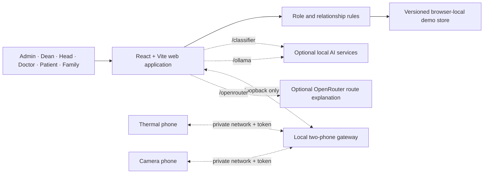

# CareBridge 3.0

> One platform for connected, consent-aware care across hospitals, clinicians, patients, and approved family caregivers.

[Open the live demo](https://carebridge-sairam.chummy-tune-1523.chatgpt.site/) · [View the GitHub repository](https://github.com/PSujith-Kumar/sri-sai-ram-hackathon-24-hr-)

CareBridge is a responsive multi-hospital healthcare-assistance prototype built for the Sairam VERDICT hackathon. It combines hospital administration, role-scoped patient access, queues, appointments, indoor navigation, health reports, medicines, family coordination, and an optional AI wellbeing companion in one React application.

The repository uses only fictional hospitals and patients. It is a demonstration platform, not a production electronic health record, diagnostic system, or emergency-dispatch service.

## Contents

- [Problem statement](#problem-statement)
- [How CareBridge solves it](#how-carebridge-solves-it)
- [Why CareBridge](#why-carebridge)
- [Demo data](#demo-data)
- [Application tour: every tab](#application-tour-every-tab)
- [Features](#features)
- [Roles and access](#roles-and-access)
- [End-to-end workflows](#end-to-end-workflows)
- [System architecture](#system-architecture)
- [Technology stack](#technology-stack)
- [Run locally](#run-locally)
- [Optional AI services](#optional-ai-services)
- [Testing](#testing)
- [Project structure](#project-structure)
- [Important business rules](#important-business-rules)
- [Privacy and security model](#privacy-and-security-model)
- [Deployment](#deployment)
- [Troubleshooting](#troubleshooting)
- [Contributing](#contributing)

## Problem statement

A hospital visit is not one isolated clinical event. It is a connected journey involving registration, queues, navigation, consultations, reports, medicines, follow-up, family support, and—sometimes—emotional or emergency assistance. In many care environments these activities are handled by separate desks, paper records, phone calls, and disconnected applications. The result is unnecessary waiting, repeated questions, missed instructions, poor visibility for caregivers, and more administrative effort for clinical teams.

The central problem is therefore not simply **“put hospital records online.”** It is:

> **How can multiple hospitals coordinate a patient's complete care journey in one understandable system while ensuring that every person sees and changes only the information they are legitimately allowed to access?**

CareBridge addresses the following practical gaps:

1. **Fragmented patient journeys.** Queue status, appointments, reports, prescriptions, directions, and care messages often live in different places and do not update one another.
2. **Unclear responsibility.** Network administrators, deans, department heads, doctors, patients, and family caregivers need different tools and different data scopes, but many systems treat access as simply “staff” or “patient.”
3. **Unsafe family access.** A caregiver may need medicine or queue information without being entitled to every clinical record. Access must depend on an approved relationship and category-level consent.
4. **Operational uncertainty.** Patients may not know where to go, how long they will wait, or whether their token has moved; staff may lack one current view of queues and assignments.
5. **Incomplete continuity of care.** A report, medicine schedule, appointment, and caregiver update should form one longitudinal story rather than unrelated entries.
6. **Support gaps between visits.** A patient may need a calm, personalized wellbeing conversation or a safe escalation path, but camera use, memory, notifications, and contact actions must remain visible and consent-controlled.
7. **Accessibility and connectivity barriers.** A useful solution must work on mobile screens, provide clear accessible routes, and demonstrate a low-bandwidth alternative rather than assuming perfect connectivity.
8. **Governance across hospitals.** A multi-hospital network needs a maintainable hierarchy—from network administrator and dean to department head and specialist—without leaking one hospital's data into another.

This repository solves those problems as a **fictional, testable prototype**. It demonstrates workflows and privacy boundaries; it does not claim regulatory certification, provide medical diagnosis, or replace an emergency service.

## How CareBridge solves it

CareBridge uses one shared, versioned care model and presents a different, permission-scoped workspace to each role. A change is recorded once and then becomes visible only in the authorized views that depend on it. For example, when a doctor creates a report, the patient can read the same report; an approved father can see it only if the relationship includes records access and the report is shared with family; an unrelated patient or doctor cannot see it.

| Problem | CareBridge capability | Result | Privacy or safety control |
|---|---|---|---|
| Disconnected hospital services | One data graph for hospitals, users, relationships, appointments, queues, reports, medicines, and notifications | Updates stay consistent across role dashboards and browser tabs | Every query is filtered by role, hospital, assignment, relationship, and action permission |
| Complex hospital hierarchy | Network, hospital, department, and clinician administration | Admins can model a dean, department heads, specialists, patients, and caregivers for multiple fictional hospitals | Hospital-scoped roles cannot cross into another hospital's workspace |
| Long and confusing waits | **QueueCare** live tokens, people-ahead count, wait estimate, queue controls, and notifications | Patients understand progress while authorized staff operate the queue | Patient views avoid exposing other patients' identities |
| Difficulty finding departments | **ClinicCompass** floor maps with predefined standard and accessible routes | Patients receive step-by-step indoor directions | Routes use fictional maps and do not track a real person's live location |
| Reports that are hard to create or review | **HealthStory** report creation with title, type, date, description, summary, sharing, printing, and detailed viewing | A clinical event becomes an understandable, reusable part of the patient's history | Access is relationship-scoped; only the creator may delete, and only within 24 hours |
| Missed or unclear medicine schedules | **MedMinder** schedules, daily status, reminders, and rollover rules | Patients can follow today's plan and clinicians can maintain assigned-patient schedules | Only the patient records a dose as taken/skipped; caregiver editing is limited to schedules that caregiver created |
| Family members either see too much or too little | **CareCircle** approved links with separate `care`, `queue`, `medications`, and `records` permissions | A father or other trusted person receives only the help context the patient approved | Relationship approval and per-category permissions are both required; report family-sharing is checked separately |
| Wellbeing support lacks context | Optional AI companion with recent conversation memory, feedback, adaptive tone, health-context controls, and mood/safety signals | Responses can become more relevant to the individual instead of repeatedly asking the same questions | Memory and clinical context are explicit settings; stored conversation history is limited to 30 days and can be cleared |
| Camera-based safety features feel invasive | Explicit simulator, thermal phone, CCTV phone, and both-sensors test modes with a visible three-state privacy model | Teams can test sensor escalation while users always know whether sensors are off, armed, or actively streaming | Browser permission is required; phone gateway tokens, short leases, payload limits, and local-only handling reduce exposure |
| Urgent support is delayed | Consent-based favourite-contact notification and a user-confirmed emergency-call handoff | Panic or emergency test scenarios have a clear escalation path | The demo never silently places a real call and does not present AI output as diagnosis |
| Poor or intermittent connectivity | Responsive progressive web interface plus a low-bandwidth USSD simulator | Core journey concepts can be demonstrated beyond a desktop-only experience | The USSD flow uses fictional data and simulated actions |

### Connected-care example

1. An administrator creates a fictional hospital, its departments, leadership, doctors, queues, and map.
2. A doctor is assigned to a patient; the patient separately approves a family caregiver and chooses exactly which categories that caregiver may access.
3. The patient joins a queue. Queue staff advance the token, and the patient's home and QueueCare tabs update from the same record.
4. The doctor completes the consultation, creates a descriptive report, and adds a medicine schedule. The patient can immediately open the report and view today's medicine plan.
5. If the report is marked for family sharing and the caregiver has `records` permission, it appears in the caregiver's Shared records tab. Otherwise it remains hidden.
6. Between visits, the patient can use CareCircle or the optional AI companion. Escalation follows the patient's saved consent and favourite-contact settings rather than notifying every linked person.

This flow is the core design decision behind CareBridge: **connect the work, not the permissions**. Data can support an end-to-end journey without becoming universally visible.

## Why CareBridge

Healthcare journeys are often split across separate systems: hospital administration, queue desks, clinical notes, medicine reminders, navigation, and family communication. CareBridge demonstrates how those workflows can be connected while still limiting each person to the minimum information their role and relationships permit.

The prototype focuses on five principles:

1. **Role-aware access:** an administrator, dean, doctor, patient, and family caregiver do not see the same workspace.
2. **Relationship-aware access:** doctors see assigned patients; family members see only approved relatives and approved categories.
3. **Connected workflows:** queue changes, reports, appointments, medicines, notifications, and care requests use one shared data graph.
4. **Patient consent:** family access and optional safety sensors are explicit rather than assumed.
5. **Safe demonstrations:** all hospital and patient information is fictional, and risky real-world actions remain user-confirmed.

## Demo data

The included dataset is intentionally rich enough for role and workflow testing.

| Entity | Included test data |
|---|---:|
| Hospitals | 4 |
| Departments | 12 |
| Users | 32 |
| Patients | 10 |
| Health reports | 16 |
| Medicines | 18 |
| Appointments | 10 |
| Live queues | 7 |
| Queue tokens | 6 |
| Notifications | 7 |
| AI care alerts | 3 |

The fictional network includes Sanjeevani Multispeciality Hospital, CareBridge Community Clinic, Lotus Women & Children Hospital, and Marina Heart Institute.

### Demo accounts

All demo accounts use the password `care123`.

| Workspace | Email | What to test |
|---|---|---|
| Network administrator | `admin@carebridge.demo` | Hospitals, organization structure, users, access, queues, and maps |
| Hospital dean | `dean@sanjeevani.demo` | Hospital overview, departments, staff, patients, and operations |
| Department head | `head.cardio@sanjeevani.demo` | Department overview, care team, assigned patients, reports, and queue desk |
| Specialist doctor | `meera@sanjeevani.demo` | Assigned patients, appointments, reports, medicines, queues, and alerts |
| Patient | `ananya@carebridge.demo` | Personal care journey, companion, records, medicine, queue, and family access |
| Family caregiver | `ravi@carebridge.demo` | Only the information and actions approved by the linked patient |

The login page also provides a **Choose a demo role** menu that fills the primary demo accounts automatically.

## Application tour: every tab

CareBridge does not show one universal dashboard to everyone. The sidebar is generated from the signed-in role, assigned hospital, doctor-to-patient relationships, approved family links, and the permissions on those links. If a family member does not have a permission such as `records`, that tab is removed rather than merely showing an access error after it is opened.

### Shared application controls

| Control | How it works |
|---|---|
| Hospital selector | Appears only when the current role can access more than one hospital. Changing it refreshes hospital-scoped dashboards, hierarchy, queues, people, and maps. |
| Notifications bell | Opens an accessible dialog containing only notifications addressed to the signed-in user. A notification can be marked read and can navigate to its related tab. |
| Profile chip | Shows the current fictional identity and title so role testing is easy to verify. |
| Mobile navigation | Opens as a focus-trapped drawer, closes with Escape or the backdrop, restores focus to the menu button, and prevents the hidden navigation from receiving input. |
| Sign out | Ends the current demo session without deleting browser-local demo data. |

### Network administrator workspace

| Tab | Purpose and main actions |
|---|---|
| **Overview** | Network totals, selected-hospital statistics, facility cards, hierarchy preview, and direct links to hospitals, organization, and access management. |
| **Hospitals** | Create and edit fictional hospitals, validate required metadata, set bed capacity and branding, and configure a usable floor map. |
| **Organization** | Build the hospital hierarchy, manage departments, assign department heads, inspect specialists, and verify staffing relationships. |
| **People & access** | Search users, add role-specific users, review doctor and family relationships, approve or revoke family links, and safely remove users with dependent-reference cleanup. |
| **Queue operations** | Inspect every authorized live queue, issue tokens, call or advance patients, complete or skip tokens, and pause or resume service. |
| **ClinicCompass maps** | Test indoor navigation across accessible hospitals and validate routes against the selected floor plan. |

### Hospital dean workspace

| Tab | Purpose and main actions |
|---|---|
| **Hospital overview** | Hospital-only patient, department, live-queue, and wait-time snapshot. |
| **Organization** | Maintain the assigned hospital's departments, leaders, and care teams. |
| **Staff & patients** | Review users and explicit care relationships inside the dean's hospital scope. |
| **Queue operations** | Operate queues belonging to the dean's hospital. |
| **ClinicCompass maps** | Test the hospital's indoor routes and accessibility paths. |

### Department-head workspace

| Tab | Purpose and main actions |
|---|---|
| **Department overview** | Department-level patients, care teams, queues, wait time, and upcoming work. |
| **My patients** | Shows only patients assigned to the head; supports registering or taking on an eligible patient. |
| **Queue desk** | Operates queues within the authorized clinical scope. |
| **Appointments** | Books and updates consultations for assigned patients and valid doctors. |
| **Care team** | Displays the department structure and the clinicians participating in care. |
| **Patient reports** | Creates, searches, opens, shares, and—when permitted—deletes reports. |
| **Medicines** | Maintains medicine schedules for assigned patients. |
| **ClinicCompass** | Plans accessible routes through the current hospital. |

### Doctor workspace

| Tab | Purpose and main actions |
|---|---|
| **Clinical dashboard** | Assigned-patient count, appointments, current token, recent reports, AI alerts, patient roster, and upcoming consultations. |
| **My patients** | Opens only assigned patients and supports adding a new or waiting unassigned patient. |
| **Queue desk** | Manages the doctor's queue without exposing unrelated queues. |
| **Appointments** | Creates and updates appointments for assigned patients. |
| **Patient reports** | Writes a complete report with title, type, date, description, and summary; opens reports in a readable detail view. |
| **Medicines** | Adds, edits, or removes schedules for assigned patients. |
| **ClinicCompass** | Provides route planning within the doctor's hospital. |

### Patient workspace

| Tab | Purpose and main actions |
|---|---|
| **My home** | Current queue token, people ahead, estimated wait, next destination, upcoming appointment, today's medicine, and recent health activity. |
| **AI Companion** | Text/voice conversation, mood and safety signals, response feedback, thermal and camera testing, phone pairing, incident clips, contacts, model status, and emergency support controls. |
| **AI & privacy settings** | Controls 30-day memory, adaptive tone, repetition avoidance, health-record context, sensor test mode, escalation consent, favourite contact, and memory deletion. |
| **My care team** | Shows assigned clinicians and approved family caregivers, including what each relationship is allowed to access. |
| **QueueCare** | Shows the patient's token and live progress without exposing another patient's identity. |
| **Appointments** | Shows and manages the patient's consultations. |
| **ClinicCompass** | Produces standard or wheelchair-friendly directions from one hospital location to another. |
| **HealthStory** | Creates, searches, opens, shares, prints, and conditionally deletes the patient's health reports. |
| **MedMinder** | Shows schedules and lets only the patient confirm today's dose as taken or skipped. |
| **CareCircle** | Sends **I'm okay** or **I need help** check-ins to approved caregivers and shows acknowledgements. |

### Family-caregiver workspace

| Tab | Purpose and main actions |
|---|---|
| **Family home** | A permission-filtered snapshot of the approved linked patient. |
| **Linked patient** | Confirms which patient relationship authorizes access. |
| **QueueCare** | Available only with the `queue` permission; shows the linked patient's visit progress. |
| **Appointments** | Uses the queue/visit permission and shows only the linked patient's appointments. |
| **MedMinder** | Available only with `medications`; a caregiver may manage only schedules that caregiver created. |
| **CareCircle** | Available only with `care`; acknowledges the linked patient's requests. |
| **Shared records** | Available only with `records`; displays only reports the patient or creator marked for family sharing. |

### What happens when data changes

All tabs use the same versioned data object. A queue action can therefore update the patient's home page and create a family notification; a report created by a doctor can appear in the patient's HealthStory; and an approved family acknowledgement can appear back in the patient's CareCircle. The application also listens for browser storage events, allowing two open tabs on the same origin to demonstrate cross-role synchronization.

## Features

### Hospital network administration

- Create, edit, and inspect multiple fictional hospitals.
- Maintain hospital metadata, capacity, departments, leaders, staff, and maps.
- Switch between hospitals when the signed-in role has network-wide access.
- View a hierarchy from network administrator to dean, department heads, specialist doctors, patients, and family links.
- Add and remove demo users while cleaning up their dependent relationships.

### Role and relationship access

- Separate navigation and dashboards for six roles.
- Doctors and department heads are restricted to assigned patients.
- Family access requires an approved patient relationship.
- Family permissions are independently scoped to queue, appointments, medicines, care requests, and health records.
- Cross-tab browser synchronization keeps open demo sessions consistent.

### QueueCare

- Live queue boards per doctor and department.
- Issue patient tokens and calculate people ahead and estimated wait time.
- Advance, call, complete, skip, pause, and resume queue operations.
- Synchronize queue changes with patient and approved-family notifications.
- Show a patient-friendly token card and next destination.

### Appointments

- Book and manage consultations between authorized patients and doctors.
- Validate hospital, department, doctor, date, and time relationships.
- Display upcoming appointments on role-specific dashboards.
- Support scheduled, checked-in, completed, and cancelled states.

### ClinicCompass

- SVG floor plans for every test hospital.
- Shortest-path routing between hospital locations.
- Wheelchair-accessible routes that avoid inaccessible stairs and edges.
- Administrator map editing for nodes and connections.
- Printable directions and optional AI-generated route explanations.

### HealthStory

- Create health reports with title, type, hospital, date, description, and summary.
- Open and read saved reports instead of showing only a list item.
- Search report titles, types, summaries, hospitals, and descriptions.
- Let a patient or authorized creator choose whether a report is shared with family.
- Allow deletion only by the report creator and only during the first 24 hours.
- Migrate older saved demo reports so missing descriptions remain readable.

### MedMinder

- Schedule medicines with dose instructions, time, notes, and optional duration.
- Let assigned clinicians manage a patient's medication schedule.
- Let approved family caregivers manage only medicines they added themselves.
- Let only the patient mark today's dose as taken, skipped, or unconfirmed.
- Reset stale daily dose confirmation when a new day begins.
- Notify caregivers and clinicians when relevant medicine events occur.

### CareCircle

- One-tap patient check-ins such as **I'm okay** and **I need help**.
- Deliver updates only to approved family caregivers.
- Let caregivers acknowledge requests and show the acknowledgement to the patient.
- Connect care requests to the same notification system used by reports and queues.

### Notifications

- Unread badge in the application header.
- Working notification dialog with individual navigation targets.
- Mark one notification or all notifications as read.
- Role-scoped delivery through recipient IDs.
- Persistent notifications for queue, record, medicine, and care events.

### AI wellbeing companion

- Patient-specific chat and optional speech input/output.
- English, Hindi, and Tamil safety phrases and conversational replies.
- Mood and situation classification with deterministic safety rules.
- Optional locally served fine-tuned classifier.
- Optional local Gemma 3 conversation through Ollama.
- Patient feedback labels: helpful, anger-causing, repetitive, or corrected.
- Thirty-day browser memory with automatic pruning, repetition avoidance, and a clear-memory control.
- Optional use of recorded conditions, allergies, medicines, reports, queues, and recent mood history as non-diagnostic context.
- User-selected companion name, voice, rate, pitch, language, response style, and favourite contact.

### Privacy-first sensor demonstration

- Thermal-camera simulator or optional HTTP thermal gateway.
- The built-in thermal simulator contains generated temperature values and stays available without opening a physical camera.
- Prototype **both-sensor test mode** keeps the currently selected thermal and camera sources visible together; browser/device permission is still required for a physical camera.
- Selecting the two-phone option preserves both phone sources and activates the test path instead of reverting to the PC camera.
- Outside test mode, real sensors require patient consent and CCTV opens only when a voice, text, or thermal signal requires live verification.
- Incident recording is local to the device and limited to confirmed abnormal events.
- Incident clips are stored in browser IndexedDB, capped at five, automatically expire after seven days, and can be viewed or deleted locally.
- Two phones over USB tethering or Wi-Fi can replace the simulator and PC webcam. In normal privacy mode, the thermal phone can watch heat shapes while the camera phone stays off until a change in voice, words, or thermal state calls for a live look. Gemma 3 can inspect the camera picture, and two consecutive looks must agree before the vision event is treated as confirmed. See [`PHONE_SETUP.md`](./PHONE_SETUP.md).

### Emergency support demonstration

- Prepare an emergency card with the patient's fictional MRN, age, blood group, conditions, allergies, medicines, hospital, and detected reasons.
- Provide user-confirmed `tel:` and `sms:` actions for emergency services and approved contacts.
- Prepare a compact fictional hospital USSD relay such as `*123*…#` for offline testing.
- Queue offline relay items and mark how they were sent.

CareBridge never silently completes a phone call, SMS, or USSD action. The user must confirm the action in the device dialler or messaging application.

## Roles and access

| Capability | Admin | Dean | Department head | Doctor | Patient | Family |
|---|:---:|:---:|:---:|:---:|:---:|:---:|
| View multiple hospitals | Yes | Assigned hospital | Assigned hospital | Assigned hospital | Own hospital | Linked patient's hospital |
| Manage hospitals | Yes | No | No | No | No | No |
| Manage departments and hierarchy | Yes | Yes | Department scope | No | No | No |
| Manage users | Yes | Hospital scope | Limited | No | No | No |
| View patients | Network | Hospital | Assigned | Assigned | Self | Approved link |
| Operate queues | Yes | Yes | Assigned queues | Assigned queues | Own token | With queue permission |
| Manage appointments | Oversight | Oversight | Assigned patients | Assigned patients | Own | With queue permission |
| Create reports | Authorized scope | Authorized scope | Assigned patients | Assigned patients | Own | When permitted by workflow |
| View reports | Authorized scope | Authorized scope | Assigned patients | Assigned patients | Own | Shared reports only |
| Manage medicines | Oversight | Oversight | Assigned patients | Assigned patients | Confirm dose only | With medication permission |
| Use AI companion | No | No | No | No | Yes | No |
| Change AI privacy settings | No | No | No | No | Yes | No |

These checks demonstrate the intended policy in the browser. A production system must enforce the same rules on a trusted backend for every request.

## End-to-end workflows

### 1. Patient, doctor, and father share one care journey

1. Sign in as `ananya@carebridge.demo` to see Ananya's patient workspace.
2. Ananya's patient object assigns Dr. Meera through `doctorIds` and approves Ravi through `familyLinks`.
3. Sign in as `meera@sanjeevani.demo`; Dr. Meera can see Ananya because the assignment is explicit.
4. Sign in as `ravi@carebridge.demo`; Ravi can see only Ananya and only the categories listed in his approved permission array.
5. Revoke Ravi's relationship in **People & access** and his permission-controlled tabs disappear.

### 2. Report creation, sharing, viewing, and deletion

1. An authorized doctor, department head, or patient opens **HealthStory / Patient reports**.
2. The form validates patient scope and saves title, report type, hospital, date, full description, and concise summary.
3. Opening a report shows the complete content rather than only its list row.
4. Family visibility requires both an approved family link with `records` permission and the report's family-sharing flag.
5. Delete is allowed only for the original creator and only for 24 hours from `createdAt`; the operation layer rejects every other attempt even if a button were exposed incorrectly.

### 3. Queue synchronization

1. A hospital operator issues or advances a queue token.
2. `queueOps.js` validates the transition and returns immutable updated state.
3. Recipient IDs are calculated from the patient, approved family relationships, and authorized staff.
4. The patient's **My home** and **QueueCare** tabs update from the same queue state.
5. Matching users receive a navigable notification; unrelated users receive nothing.

### 4. Medicine scheduling and daily confirmation

1. An assigned clinician creates a schedule with medicine, dose, time, instruction, notes, and optional end date.
2. An approved caregiver with `medications` permission may add a schedule, but may later edit or remove only that caregiver-created item.
3. The patient marks today's dose taken or skipped.
4. The minute-based rollover check clears yesterday's confirmation when the local date changes.

### 5. AI and sensor escalation

1. Deterministic emergency phrases and clinical boundary rules run before generative AI.
2. Voice, text, medicine, thermal, and optional camera observations are combined into a non-diagnostic wellbeing assessment.
3. A soft signal such as a changed voice can request a live look but cannot by itself confirm an incident.
4. A camera observation or a sustained thermal anomaly can move the privacy guard from **thermal-only** to **verifying** and then **recording**.
5. Only a confirmed abnormal event creates a local incident clip and care-circle/hospital demo alerts.
6. When the situation becomes calm and the patient responds, recording and the event-triggered camera check stop automatically.

### 6. Two-phone testing

1. Run CareBridge locally with `start.bat` or `npm run dev`; hosted static copies cannot reach the PC's private phone gateway.
2. Open **AI Companion → Phone cameras**, choose the correct USB-tethering or Wi-Fi address, and scan one QR code with each phone.
3. On the thermal phone choose a thermal attachment, privacy-preserving silhouette, or test pattern.
4. Select **Use these two phones as my sensors**. CareBridge preserves `thermal: phone` and `CCTV: phone`; it does not fall back to this device's camera.
5. In the current prototype test mode, both selected phone sources may remain active for immediate verification. Turn off test mode to return to event-triggered normal-camera behavior.

For detailed network, certificate, firewall, and phone instructions, see [`PHONE_SETUP.md`](./PHONE_SETUP.md).

## System architecture



### Runtime data flow

1. `src/data.js` supplies a connected fictional seed dataset.
2. `hydrateCareData()` combines compatible saved browser state with current defaults.
3. A versioned local-storage key prevents outdated schemas from breaking newer releases.
4. Pure operation modules validate permissions and return new immutable state.
5. React pages render only the entities visible to the current role and relationships.
6. Notifications connect changes across queues, reports, medicines, appointments, and care requests.

### Trust boundaries

| Boundary | Current prototype behavior | Production requirement |
|---|---|---|
| Browser ↔ demo data | Same-origin browser storage; no central clinical database | Authenticated API, encrypted database, audit events, backups, retention policy |
| UI ↔ authorization | Pure operation functions and role-filtered UI | Repeat every authorization check on a trusted server; never trust client claims |
| Browser ↔ local AI | Vite proxies to localhost services | Authenticated private inference service with consent, logging policy, and data-processing agreement |
| Browser ↔ OpenRouter | Server-side development proxy holds the key | Managed secret store, egress policy, redaction, and explicit patient consent |
| PC ↔ phones | Private-network source, short random token, local in-memory relay | Device enrollment, mutually authenticated transport, rotation, revocation, monitoring, and documented clinical ownership |

The default deployment is a static application. It does not include a production database or server authentication.

## Technology stack

| Area | Technology |
|---|---|
| Frontend | React, JSX, Vite |
| Styling | Responsive CSS with Tailwind/PostCSS tooling and a CareBridge design system |
| Icons | Lucide React |
| Tests | Vitest |
| Maps | SVG floor plans and pure JavaScript graph routing |
| Local conversation model | Optional Gemma 3 through Ollama |
| Mood classifier | Built-in browser model or optional Python local service |
| Route explanation | Optional OpenRouter-compatible API through a protected Vite proxy |
| Persistence | Versioned browser `localStorage` for demo data |
| Hosting | Static production bundle generated in `dist/` |

### Prerequisites

- Node.js `^20.19.0` or `>=22.12.0`
- npm
- A modern Chromium, Firefox, or Safari browser
- Python 3 only if running or training the optional classifier
- Ollama only if using local Gemma 3 conversation

## Run locally

### Fastest option on Windows

Double-click [`start.bat`](./start.bat).

The script:

1. checks that Node.js and npm are available;
2. installs dependencies if `node_modules` is missing;
3. starts the Vite development server; and
4. opens CareBridge in the default browser.

### Command line

```bash
git clone https://github.com/PSujith-Kumar/sri-sai-ram-hackathon-24-hr-.git
cd sri-sai-ram-hackathon-24-hr-
npm ci
npm run dev
```

Open <http://127.0.0.1:5173/> if the browser does not open automatically.

### Production build

```bash
npm run build
npm run preview
```

The optimized static output is written to `dist/`.

### Available npm scripts

| Command | Purpose |
|---|---|
| `npm run dev` | Start the local Vite development server on `127.0.0.1` |
| `npm run build` | Create the optimized production bundle |
| `npm run preview` | Serve the production bundle locally |
| `npm run check` | Run the production build as a validation check |
| `npm test` | Run the complete Vitest suite once |
| `npm run phones:simulate` | Pretend to be the thermal phone and the camera phone (start `npm run dev` first) |

## Optional AI services

CareBridge works without external AI services. Its fixed safety rules and built-in fallback classifier remain available when optional services are offline.

### Local fine-tuned mood classifier

The recommended optional classifier runs on the same computer and binds only to `127.0.0.1:8765`.

```bash
pip install torch transformers scikit-learn numpy scipy
python ml/serve.py
```

In another terminal:

```bash
npm run dev
```

`ml/serve.py` runs a fine-tuned Gemma 3 270M (`python ml/finetune_gemma.py --final`, weights from `unsloth/gemma-3-270m-it`) together with the e5 model and averages them, using whichever are trained. On held-out sentences Gemma 3 catches more serious situations than e5 (91.2% against 82.1%) with fewer false alarms (1.5% against 2.9%), and the pair is best at mood (92.7%). Details and limits are in [`ml/GEMMA_REPORT_eval.md`](./ml/GEMMA_REPORT_eval.md).

Vite proxies `/classifier` to the local service. Patient text is not logged by the included server. See [`ml/README.md`](./ml/README.md) and [`ml/REPORT.md`](./ml/REPORT.md) for data, training, evaluation, and limitations.

### Local Gemma 3 with Ollama

Install Ollama, then download and run a supported model:

```bash
ollama pull gemma3:4b
```

Keep Ollama running and start CareBridge with `npm run dev`. Vite proxies `/ollama` to `http://127.0.0.1:11434`. Enable Gemma from the patient's AI settings or companion page.

Supported presets in the UI include `gemma3:1b`, `gemma3:4b`, and `gemma3:12b`. The 4B preset is the default recommendation in the application. The 4B and larger models can also read the camera picture when the camera phone is switched on (see [`PHONE_SETUP.md`](./PHONE_SETUP.md)); the 1B model cannot see images.

### OpenRouter route explanations

ClinicCompass routing works without an API key. An OpenRouter key only enables optional natural-language route analysis.

1. Copy `.env.example` to `.env.local`.
2. Add your key:

```dotenv
OPENROUTER_API_KEY=your_key_here
```

3. Restart `npm run dev`.

The Vite server adds the authorization header. The key is not sent to or stored in the browser. Never commit `.env.local` or a real API key.

### Optional voice-cloning endpoint

Set `VITE_TTS_ENDPOINT` only when using a trusted speech service that accepts the application's `{ text, sample }` request and returns an audio response.

Because a `VITE_` variable is exposed to browser code, do not place secrets directly in `VITE_TTS_ENDPOINT` or any other `VITE_*` value.

## Testing

Run all automated tests:

```bash
npm test
```

Run the production build check:

```bash
npm run check
```

The test suite covers:

- hospital and user administration;
- organization hierarchy operations;
- doctor-to-patient assignment;
- appointments and scheduling validation;
- queues, token progression, and recipients;
- CareCircle permissions and acknowledgements;
- report creation, descriptions, sharing, viewing, migration, and 24-hour deletion rules;
- medicine scheduling, permissions, daily rollover, and adherence;
- map routing and accessibility;
- AI companion safety decisions, mood classification, multilingual phrases, memory, voice signals, thermal simulation, and offline relay behavior;
- legacy browser-data migration, including the regression that previously caused a blank screen.

The latest verified build contains **401 passing tests across 22 test files**.

## Project structure

```text
carebridge-app/
├── src/
│   ├── admin/                 # Hospital, map, and user administration UI
│   ├── companion/             # AI companion, safety, memory, sensors, and relay
│   ├── doctor/                # Doctor-specific patient workflow UI
│   ├── pages/                 # Queue, appointment, organization, and care pages
│   ├── App.jsx                # Login, shell, routing, dashboards, records, notifications
│   ├── data.js                # Connected fictional seed dataset and demo accounts
│   ├── careFlow.js            # Records, notifications, migration, shared care helpers
│   ├── adminOps.js            # Hospital and identity operations
│   ├── appointmentOps.js      # Appointment rules
│   ├── careCircle.js          # Patient-family care requests
│   ├── doctorOps.js           # Patient registration and assignment
│   ├── mapAnalysis.js         # Route analysis and optional AI explanation
│   ├── medminder.js           # Medicine permissions and operations
│   ├── orgOps.js              # Department and hierarchy operations
│   ├── queueOps.js            # Queue and token operations
│   └── index.css              # Responsive CareBridge interface styles
├── server/                    # Phone gateway: pairing, frame relay, HTTPS listener, Vite plugin
├── public/phone/              # The page the thermal phone and the camera phone open
├── scripts/                   # Phone simulator and sample pictures
├── tests/                     # Vitest unit and regression tests
├── ml/                        # Dataset generation, training, evaluation, and local service
├── design-system/             # CareBridge visual design guidance
├── dist/                      # Generated production bundle
├── .openai/hosting.json       # Static hosting metadata
├── start.bat                  # Windows one-click launcher
├── vite.config.js             # React build and optional local-service proxies
└── package.json               # Scripts and dependencies
```

Most business rules are pure functions outside React components. This keeps permission checks testable and reduces the chance that different dashboards implement conflicting behavior.

## Important business rules

### Patient visibility

- An administrator can inspect all patients in the demonstration network.
- A dean is restricted to patients in an assigned hospital.
- A department head or doctor sees only patients whose `doctorIds` include that user.
- A patient sees only the patient profile connected to their own user ID.
- A family caregiver sees only patients with an approved family link to that user.

### Family permissions

An approved relationship is not automatically full access. Each link has a permission list such as:

- `queue`
- `medications`
- `care`
- `records`

UI navigation and operations check the relevant permission before exposing information or actions.

### Report deletion

A health report can be deleted only when both conditions are true:

1. the current user is the report creator; and
2. fewer than 24 hours have elapsed since `createdAt`.

After the window expires, the report remains available but the delete action is refused.

### Medicine permissions

- Assigned doctors and department heads can schedule, edit, and remove medicines for their patients.
- Approved family caregivers with medication permission can schedule medicine.
- A family caregiver can edit or remove only the medicine that same caregiver added.
- Only the patient can confirm a dose as taken or skipped.

### AI escalation

The safety pipeline is conservative and layered:

1. deterministic symptom and emergency phrase rules run first;
2. the built-in or local classifier may raise concern but cannot lower a rule-based result;
3. Gemma may help write the response and may raise concern within limits, but it cannot override emergency rules downward;
4. urgent events notify the approved care circle;
5. critical events can also create a fictional hospital alert or offline relay item.

## Privacy and security model

CareBridge follows privacy-by-design ideas in its workflows, but this repository is still a hackathon prototype. The distinction is important: the application demonstrates how access and consent should behave; it does not claim that browser-only controls are sufficient protection for real medical data.

### Security and privacy summary

| Area | Protection implemented in this prototype | Important limitation |
|---|---|---|
| Demo data | Every bundled hospital, person, report, medicine, appointment, alert, and queue item is fictional. | Never import real patient information into this build. |
| Sign-in | Role-specific demo accounts make access paths testable. | The shared password `care123` and browser-side authentication are intentionally not production security. |
| Authorization | Pages and pure operation functions check roles, hospital scope, assigned doctors, family-link status, and per-link permissions. | A malicious browser user can modify client code or storage; production authorization must run again on the server. |
| Data minimization | Doctors see assigned patients; family users see one approved relationship and only permitted categories; notifications have explicit recipient IDs. | All seed data ships in the static JavaScript bundle, so this is appropriate only for fictional demo data. |
| Persistence | Versioned `localStorage` keeps structured demo state; schema hydration prevents older data from crashing a newer build. | The app does not encrypt local storage. Any script running under the same origin may be able to read it. |
| Reports | Family sharing is a separate flag; deletion requires creator identity and a 24-hour window. | Real documents need encrypted object storage, malware scanning, audit logs, and server-side retention rules. |
| AI memory | Conversation memory is patient-specific, browser-local, limited to 30 days, optional, and patient-clearable. | Browser clearing is not a regulated deletion receipt; production needs an auditable retention/deletion service. |
| Incident clips | Stored only in local IndexedDB, maximum five clips, seven-day expiry, manual deletion available. | Local device users or malware may still access browser storage; production needs managed keys, policy enforcement, and audit. |
| API secrets | The OpenRouter development key stays in the Vite server proxy rather than browser code. | A static deployment cannot safely hold server secrets; use a managed backend or secret binding. |
| Emergency actions | `tel:`, SMS, and fictional USSD actions require a visible user tap and device confirmation. | CareBridge does not prove that a call or message was completed and is not an emergency-dispatch system. |

### Role, relationship, and permission enforcement

Access is calculated in layers:

1. **Role** decides which categories of work are available—for example, only an administrator can manage hospitals.
2. **Hospital scope** limits leaders and clinicians to their assigned facilities.
3. **Clinical assignment** limits doctors and department heads to patient IDs explicitly containing their user ID.
4. **Family relationship** requires a matching `familyLinks` entry with `status: approved`.
5. **Family permission** separately gates `queue`, `medications`, `care`, and `records`.
6. **Operation rule** rechecks the actor when a mutation is attempted, such as report deletion or medicine editing.

This prevents an accidental UI route from becoming an automatic authorization grant. In production, the same model should be represented in signed server sessions and enforced on every API query and mutation.

### Browser storage and retention

- The principal demo dataset is stored under a versioned same-origin `localStorage` key.
- `hydrateCareData()` supplies newly introduced arrays and defaults when older browser data is loaded.
- Clearing site data resets the application to the current fictional seed.
- AI messages are pruned according to the patient's configured retention window, which defaults to 30 days.
- Incident video blobs use IndexedDB rather than `localStorage`, are capped at five, and expire after seven days.
- Phone frames are never written by the gateway: only the newest frame exists in server memory.

Local storage is convenient for a self-contained demonstration, but it is neither encrypted clinical storage nor a multi-user database. A real deployment needs encrypted records, separate tenant boundaries, backup and restore, legal retention rules, deletion evidence, and a complete audit trail.

### AI privacy and safety boundaries

- Deterministic emergency and medication-safety rules execute independently of Gemma and cannot be lowered by a model response.
- Gemma is optional. When unavailable, fixed and tested replies remain active.
- The bundled mood classifier runs in the browser. The optional Python classifier binds to `127.0.0.1:8765` and the included service does not log patient text.
- Ollama can keep Gemma inference on the same computer. A remote endpoint can transmit patient text, camera images, or audio and must not be enabled without informed consent and an approved processor.
- Health conditions, allergies, medicines, and report summaries are used only when **Use health-record context** is enabled.
- Response feedback is stored with the patient's local conversation memory and is used to avoid anger-causing or repetitive replies; it is not autonomous model retraining.
- AI output is supportive and non-diagnostic. It must never replace a qualified clinician, prescription, or emergency service.

### Thermal and camera privacy state machine

The normal privacy path is a tested three-state guard:

| State | Thermal source | Normal camera | Recording | Exit condition |
|---|---|---|---|---|
| `thermal-only` | Active when permitted | Off | Off | Thermal, voice, or text concern requests verification |
| `cctv-verifying` | Active | Live view | Off | Confirmed concern starts recording; calm state returns to thermal-only |
| `recording` | Active | Live view | Local only | Patient response plus a sustained calm period stops recording |

A changed voice or worrying phrase is a **soft signal**: it may open a live view but can never confirm an incident by itself. A camera observation or a thermal anomaly sustained for the configured confirmation period is required before recording and alert effects begin.

For hackathon testing, `sensorTestMode` is enabled in the default profile. It keeps the currently selected thermal and camera sources active together so both panels can be demonstrated. It does not bypass the browser's physical-camera permission prompt, upload frames, or automatically start incident recording. Turning test mode off returns to the event-triggered guard above. No real camera should be used without the informed consent of everyone visible.

### Two-phone gateway protections

The phone gateway is deliberately local and short-lived:

- Phone-facing requests are accepted only from loopback, private RFC 1918, link-local, or private IPv6 addresses.
- Each patient pairing receives a random 128-bit token; token comparison uses constant-time equality.
- The QR fragment supplies the token to the phone page, which sends it in a request header rather than placing it in ordinary server logs.
- The CareBridge consumer API accepts only loopback requests from the same origin, blocking another device or website from controlling cameras.
- Local HTTPS is used when the development certificate is available, and the UI shows a certificate fingerprint prefix for visual confirmation.
- Thermal input is validated as a bounded numeric grid; normal-camera input must be JPEG.
- Payload limits, minimum frame intervals, and failed-token rate limits reduce accidental or abusive traffic.
- Capture permission is a renewable lease: thermal permission expires after roughly 30 seconds and camera permission after roughly 20 seconds if CareBridge stops renewing it.
- Frames sent while a camera is not requested are refused. Turning a phone camera off deletes its last buffered frame immediately.
- Only the newest thermal and camera frames are held in memory; the gateway writes no frame to disk and logs no frame content.
- **New pairing** rotates the token and immediately invalidates the old QR links.

The local phone gateway is available only when running the project on the PC. A static public site cannot directly reach devices on a private USB-tethering or Wi-Fi network.

### Notifications and emergency privacy

Notifications contain a `recipientIds` allowlist and are filtered for the signed-in demo user. Queue, report, medicine, and care actions calculate their intended recipients rather than broadcasting every event. Because the entire implementation is client-side, this remains a UX demonstration; production notification delivery must occur from an authorized server and avoid sensitive content on lock screens.

India emergency `112` and Tele-MANAS `14416` are displayed for user-confirmed calls. Verify numbers, regulations, and hospital protocols before real deployment. The `*123*…#` relay and placeholder SMS destination are fictional demonstration values and are not connected to a hospital or government service.

### Production security checklist

Before using CareBridge with real people or records, replace or add all of the following:

- standards-based identity such as OIDC/SAML, MFA for staff, secure password recovery, and short-lived sessions;
- server-side RBAC plus relationship/consent checks on every request;
- encrypted databases and object storage with managed key rotation;
- append-only access, consent, export, and deletion audit trails;
- field-level data minimization and separate hospital/tenant boundaries;
- signed upload/download URLs, file-type validation, antivirus scanning, and report provenance;
- CSRF protection, a strict Content Security Policy, secure cookies, dependency scanning, and rate limiting;
- device enrollment and mutually authenticated transport for approved cameras;
- secrets management and explicit egress controls for every AI provider;
- clinical validation, accessibility testing, incident response, backups, disaster recovery, and applicable regional compliance review.

### Demonstration and medical limitations

- CareBridge is not a medical device and does not diagnose, prescribe, or change a dose.
- Queue times and map directions are estimates; real facilities must provide verified maps and operations data.
- Mood, voice, thermal, and vision classifications are non-diagnostic development signals and can be wrong.
- The system must not be used as the only mechanism for monitoring a vulnerable person.
- A real deployment requires clinical ownership, human escalation procedures, and independent security/privacy review.

## Deployment

Current public demo:

<https://carebridge-sairam.chummy-tune-1523.chatgpt.site/>

Build the deployable output with:

```bash
npm ci
npm test
npm run build
```

Publish the contents declared by `.openai/hosting.json`; the static directory is `dist`.

A GitHub push updates source control. It does not by itself guarantee that the hosted Site has published the new bundle unless a deployment integration or CI workflow is configured. After deployment, verify the production asset name, open the principal role dashboards, test the notification dialog, and check the browser console for runtime errors.

## Troubleshooting

### The page is blank after an update

1. Hard-refresh the page.
2. Check the browser console for the first runtime error.
3. Confirm the production bundle matches the latest `dist/assets` file.
4. Clear the site's browser storage if testing an old deployment.
5. Run `npm test` to verify data-migration regressions.

The application uses a versioned demo-data key and defensive migration to prevent older saved records from causing `undefined.join(...)` failures.

### Port 5173 is already in use

Stop the other Vite process, or start CareBridge on another port:

```bash
npm run dev -- --port 5174
```

### The classifier shows the built-in model

Start `python ml/serve.py`, confirm <http://127.0.0.1:8765/health> responds, and restart Vite if necessary. CareBridge continues safely with its built-in fallback when the service is unavailable.

### Gemma is not connected

Confirm Ollama is running and the selected model is installed:

```bash
ollama list
ollama pull gemma3:4b
```

Then use **Test connection** in the AI companion model card.

### OpenRouter analysis is unavailable

Confirm `.env.local` contains `OPENROUTER_API_KEY`, restart the Vite server, and check `/openrouter/status`. Normal ClinicCompass routing does not require this service.

### Demo data needs to be reset

Clear storage for the CareBridge origin in the browser's site settings, then reload. Do not do this if you need to preserve unsaved demo changes.

## Contributing

1. Pull the latest `main` before making changes.
2. Keep business rules in the operation modules when possible.
3. Add or update tests for every permission or data-shape change.
4. Run `npm test` and `npm run build`.
5. Check `git diff` for generated secrets, personal data, or unrelated files.
6. Commit with a focused message and push to GitHub.
7. Publish and smoke-test the hosted version when the change should be live.

When adding demo content, use only fictional data. Never commit real patient information, credentials, private API keys, camera recordings, model artifacts containing sensitive data, or `.env.local`.

---

Built as a healthcare coordination prototype for the Sairam VERDICT hackathon.
